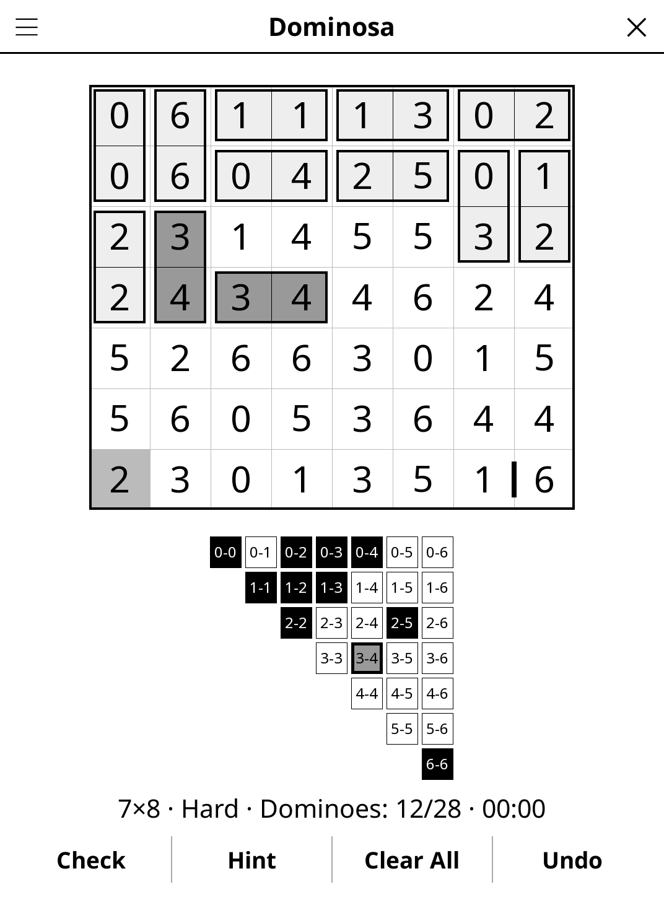

# dominosa.koplugin

A Dominosa puzzle plugin for [KOReader](https://github.com/koreader/koreader).

## Screenshot

## Rules

The grid holds a complete set of dominoes (0-0 up to the largest digit), laid
face up with their outlines removed. Find where each domino lies: every cell
belongs to exactly one domino, and each pair of numbers appears exactly once.

## Features

- **Four sizes** — digits 0-3 (4×5) up to 0-6 (7×8, a full double-six set)
- **Three difficulty levels** — every puzzle has exactly one solution, proven
  by a logical solver at generation. Easy needs only "this cell / this pair
  has a single place left"; Medium also needs "every place left for this
  pair uses this cell"; Hard also needs a one-step "what if" trial.
- **Pair table** — shows which pairs you have used, and flags any used twice
  (those dominoes are also shaded darker on the board)
- **Barriers** — mark borders where no domino can go
- **Hint** — two taps: the first names a domino the logic forces next (or a
  wrong one you placed), the second places (or removes) it
- **Check**, **Undo**, **Clear All**, timer, auto-save

## Installation

1. Download `dominosa.koplugin.zip` from the [latest release](../../releases/latest).
2. Extract into the `plugins/` folder of your KOReader data directory.
3. Restart KOReader.
4. Open the menu → **Tools** → **Dominosa**.

## Controls

| Action | How |
|--------|-----|
| Place a domino | Tap the border between two cells, or tap one cell then its neighbour |
| Remove a domino | Tap the same border again, or tap one of its cells |
| Mark "no domino here" | Hold a border (hold again to clear) |
| Check progress | Tap **Check** |
| New puzzle, size, difficulty, rules | Title-bar menu |

## License

GPL-3.0 — see [LICENSE](LICENSE).
